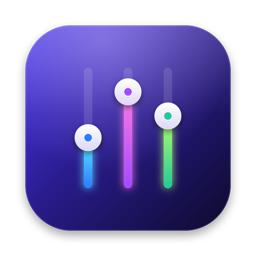
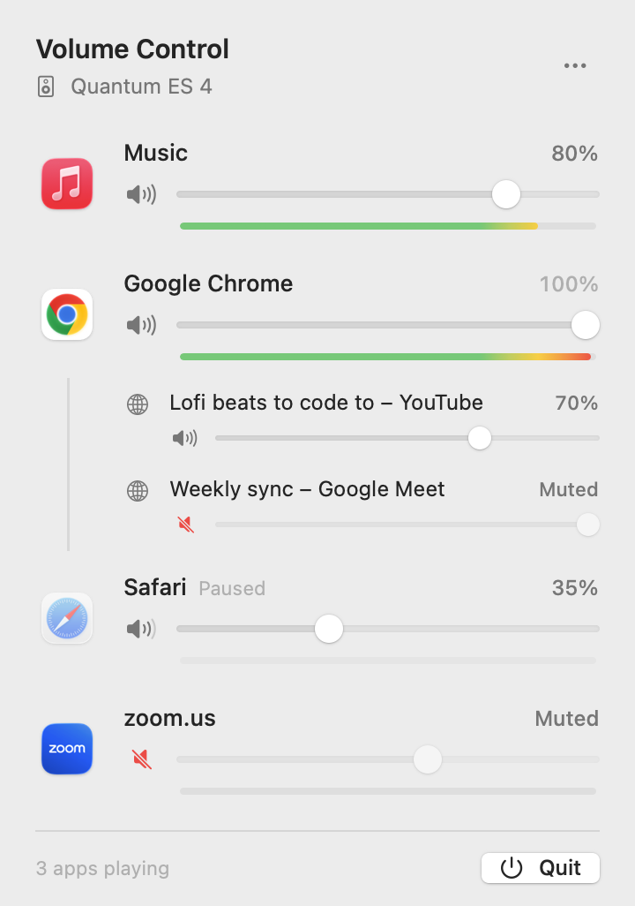
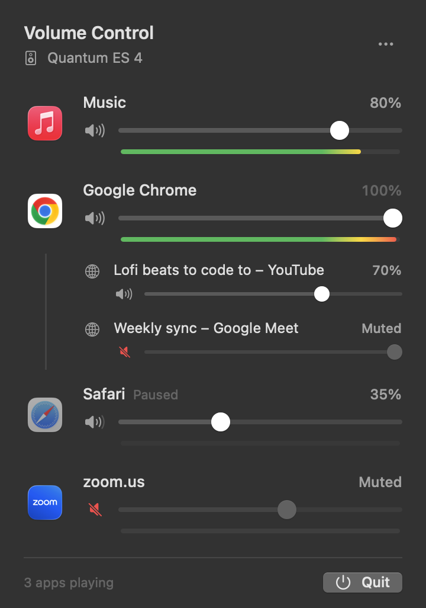
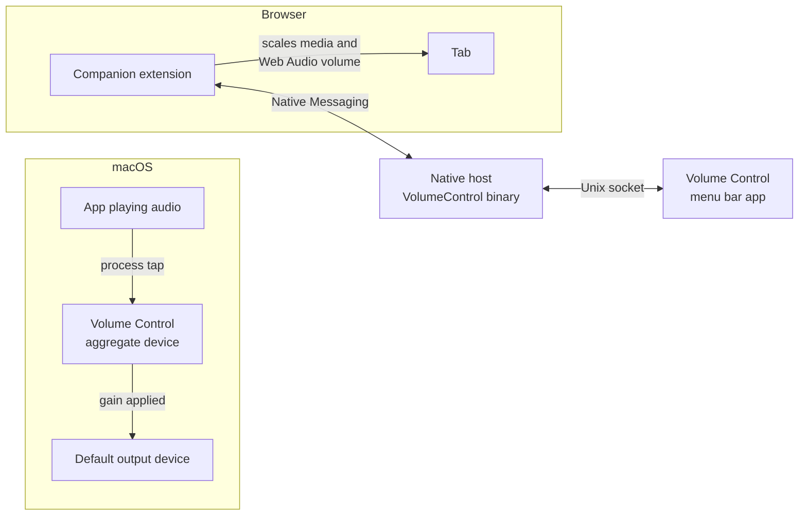

<p align="center">
  
</p>

<h1 align="center">Volume Control</h1>

<p align="center">
  A native macOS menu bar mixer: set the volume of every app — and every browser tab — independently.
</p>

<p align="center">
  
  &nbsp;&nbsp;
  
</p>

## Features

- **Per-app volume.** Every app that's playing sound gets its own row with a slider from 0–100%, or up to 150% with boost turned on.
- **Per-tab volume for Chromium browsers.** With the companion extension installed, each audible tab in Chrome, Edge, Brave, Arc or Vivaldi shows up under its browser with its own slider and mute button.
- **Live level meters.** Each row has a peak meter on a decibel scale, green through yellow to red near 0 dBFS. Meters only run while the menu is open.
- **No driver to install.** Built on Core Audio process taps (macOS 14.2+), so there's no kernel extension or virtual audio device.
- **Leaves untouched apps alone.** An app at 100% isn't routed through Volume Control at all; its audio is only captured once you change its level.
- **Follows your output device.** It switches along with the system default output, including USB interfaces, AirPods and HDMI.
- **Remembers your settings.** Levels are saved per app and come back the next time that app plays.

### Using it

| Action | How |
| --- | --- |
| Change an app's or tab's volume | Drag its slider |
| Mute or unmute | Click the speaker icon, or right-click the row |
| Reset to 100% | Double-click the percentage, or right-click → **Reset to 100%** |
| Boost, launch at login, reset everything | The **⋯** menu in the top-right corner |
| Quit | **Quit** button in the footer, or ⌘Q while the menu is open |

When an app stops playing it stays listed as **Paused** for a few seconds, so rows don't jump around while you skip tracks.

## Requirements

- macOS 14.2 or later
- A Swift 6 toolchain (Xcode 16+ or the Command Line Tools)
- For per-tab control: a Chromium-based browser (version 111+)

## Build and install

```sh
git clone https://github.com/hdstech/volume-control.git
cd volume-control
make install
```

`make install` builds a release `.app`, copies it to `/Applications/VolumeControl.app`, and launches it. The slider icon appears in your menu bar.

The first time an app's volume is changed, macOS asks for **audio recording** permission. That's the permission Core Audio process taps require. If you decline, you can turn it on later under **System Settings → Privacy & Security → Screen & System Audio Recording**, or use the button in the menu.

Other `make` targets:

| Target | What it does |
| --- | --- |
| `make run` | Build the `.app` into `build/` and launch it from there |
| `make list` | Print every Core Audio process, whether it's playing, and which app it's attributed to |
| `make test` | Run the unit tests |
| `make snapshots` | Re-render the screenshots in `docs/` |
| `make icon` | Redraw `Resources/AppIcon.png` |
| `make clean` | Remove build output |

## Per-tab browser volume

macOS only sees a browser as one audio source, so Volume Control can't separate tabs by itself. The **Volume Control Companion** extension fills that gap.

1. Open `chrome://extensions` (or `edge://extensions`, `brave://extensions`, …).
2. Turn on **Developer mode**.
3. Click **Load unpacked** and choose the `BrowserExtension` folder. You can also open the app's **⋯** menu and pick **Show Browser Extension…** to find the copy inside the installed app.

Audible tabs now appear under the browser's row. Until the extension connects, the browser row shows a hint pointing you to it.

## How it works



**App volume.** Volume Control watches Core Audio's process list for processes that are producing output. When you move an app away from 100%, it creates a `CATapDescription` tap for that app's processes in *muted when tapped* mode. It then routes the captured audio through a private aggregate device and plays it back on your output device with your gain applied. The gain is shared with the real-time audio thread through lock-free atomics and ramped across each buffer, so moving a slider never clicks. Level meters use the same taps in listen-only mode, which measures the audio without changing it.

**Finding the right app.** Sound usually comes from a helper process such as `Google Chrome Helper`, `com.apple.WebKit.GPU`, or an Electron app's `Helper` rather than the app itself. Volume Control walks each process's "responsible" PID and parent chain back to the app you'd recognize, and groups everything under it.

**Browser tabs.** The extension injects a small script into each page that scales `HTMLMediaElement` volume and routes Web Audio graphs through a gain node. Its background worker talks to the app over Chrome's Native Messaging protocol; the app registers itself as the native host for every installed Chromium browser and relays messages over a local Unix socket.

## Project layout

```
Sources/
  VolumeControl/        The menu bar app
    Audio/              Process taps, device and process monitoring, app attribution
    Browser/            Native Messaging host, socket bridge, host installer
    Model/              AudioController (app state) and saved settings
    UI/                 SwiftUI menu, rows, level meters
  VolumeControlKit/     Real-time-safe DSP and pure logic (unit tested)
  CAtomics/             Lock-free atomics for the audio thread
BrowserExtension/       Volume Control Companion (Manifest V3)
Scripts/                App bundling and icon rendering
```

## Limitations

- Safari and Firefox tabs can't be controlled individually; those browsers are still controllable as a whole app.
- Apps that bypass the system mixer (some pro audio apps using exclusive device access) may not be tappable.
- The app is ad-hoc signed for local use. It isn't notarized, so a copy downloaded from elsewhere needs to be allowed in **System Settings → Privacy & Security** the first time.
